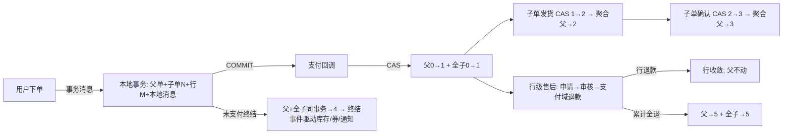

# 技术方案: 订单拆单与行级售后改造

> 机器可读的迭代协议产物之一。把 prd.md 的 REQ 转化为**实现任务与观测点**，记录系统链路与改造点。
> 纪律：具体方法逻辑以代码为准，本文件只说明「调哪个接口/方法 + 它在整条链路中的位置」。

## 方案概述

按**四阶段**实施（禁止 big bang），每阶段独立可编译可测试、可单独验收：

| 阶段 | 内容 | 独立价值 |
|---|---|---|
| ① 分摊落库 | 下单摊到行并持久化；售后改用存量（重算降级为校验/兜底） | 行级金额账务化；退补口径的地基 |
| ② 售后挂行 | 售后单锚点从"订单+SKU"改为 `item_id` | 行级售后粒度 |
| ③ 拆单 | 商家维度子单 + 父单聚合 + 支付/终结链路扩展 | 一次支付 = 多份履约 |
| ④ 履约下沉 | 发货/确认/退款收敛按子单；接口与 VO | 履约/售后展示锚点 |

## 系统链路（现状 → 目标）



- 跨系统上下游：订单域 ↔ 支付域（退款契约不变：`refundByOrder` + 全退通知）、订单域 ↔ 库存域（预扣/确认/回补不变）、订单域 ↔ 商品域（新增 `sellerId` 下发）；
- 新旧切换：阶段 ①② 不改变对外结构（`item_id` 内部锚定）；阶段 ③④ 改变详情/列表/履约接口结构；
- 废弃状态：无（父单 0~5 语义保持）。

## REQ → 任务映射

> 每条 REQ 必须有承接任务；每条 AC 必须有对应任务或观测点。

### 阶段① 分摊落库（REQ-2）

| REQ/AC | 实现任务 | 涉及文件/模块 | 观测点 |
|--------|---------|--------------|--------|
| REQ-2/AC-2 | T1.1 DDL：`t_order_item_0..3` 增 `discount_share DECIMAL(10,2) DEFAULT 0` | `sql/init-all.sql` | 建表语句 |
| REQ-2/AC-2 | T1.2 `OrderItem` 增 `discountShare` | `entity/OrderItem.java` | 字段映射 |
| REQ-2/AC-2 | T1.3 创建落库：`OrderTransactionService` 调 `DiscountAllocator.allocateByItems(items, discountAmount)` → 逐行 set | `service/OrderTransactionService.java` | 单测：Σshare=优惠额 |
| REQ-2/AC-2 | T1.4 售后改用存量：`AftersaleService.entitlement` 以 `item.getDiscountShare()` 为准（重算仅校验不一致告警） | `service/AftersaleService.java` | 单测：存量口径 |
| REQ-2/AC-2 | T1.5 测试：守恒/取整/退满补齐 | `src/test/...` | 测试报告 |

### 阶段② 售后挂行（REQ-3）

| REQ/AC | 实现任务 | 涉及文件/模块 | 观测点 |
|--------|---------|--------------|--------|
| REQ-3/AC-3 | T2.1 DDL：`t_aftersale` 增 `item_id BIGINT NOT NULL`；唯一键改 `(item_id, type)`（保留 `order_id`/`sku_id` 冗余查询列） | `sql/init-all.sql` | 建表语句 |
| REQ-3/AC-3 | T2.2 `Aftersale` 增 `itemId`；`buildEntity` 绑定 item | `entity/Aftersale.java`、`service/AftersaleService.java` | 单测 |
| REQ-3/AC-3 | T2.3 全链路 item 锚：apply/audit/retry/recover 的查询与复核按 item | `service/AftersaleService.java`、`repository/AftersaleRepository.java` | 单测：行级闸门 |

### 阶段③ 拆单（REQ-1/4/5/8）

| REQ/AC | 实现任务 | 涉及文件/模块 | 观测点 |
|--------|---------|--------------|--------|
| REQ-8/AC-8 | T3.1 商品域：`t_sku` 增 `seller_id`；`Sku`/`SkuVO` 增 `sellerId`；下单映射 `SkuInfoDTO` 增 `sellerId`；种子数据挂 2~3 商家 | `my-xhs-product`、`sql/init-all.sql` | 单测：下发字段 |
| REQ-1/AC-1 | T3.2 DDL：`t_sub_order_0..3`（分片 `user_id`：id/order_id/order_no/sub_order_no/user_id/seller_id/status/金额/时间戳）；`t_order_item` 增 `sub_order_id`/`seller_id` | `sql/init-all.sql` | 建表语句 |
| REQ-1/AC-1 | T3.3 `SubOrder` entity + `SubOrderMapper`（含 `selectByOrderId` 批量） | `entity/`、`mapper/` | 编译+单测 |
| REQ-1/AC-1 | T3.4 创建：按 `sellerId` 分组 → 子单（金额=Σ行）→ 行挂子单；同一本地事务 | `service/OrderTransactionService.java` | 单测：AC-1 结构 |
| REQ-4/AC-4 | T3.5 聚合：纯函数 `computeParentStatus(子单列表)`（表驱动穷尽）+ `recomputeParentStatus`（读全子单→算→CAS 父单→冲突重试） | `service/SubOrderService.java`（新） | 表驱动单测 |
| REQ-5/AC-5 | T3.6 支付回调：父 0→1 + 全子 0→1（CAS；回调幂等保持） | `service/OrderService.java` | 单测：幂等 |
| REQ-5/AC-5 | T3.7 终结：04B 本地事务内扩为"父+全子→4"；终结事件/补偿/通知链路不变 | `service/OrderTerminationService.java` | 单测：全子取消 |

### 阶段④ 履约下沉与收敛（REQ-5/6/9）

| REQ/AC | 实现任务 | 涉及文件/模块 | 观测点 |
|--------|---------|--------------|--------|
| REQ-5/AC-5 | T4.1 发货：`deliver(userId, subOrderNo, ...)` **先校验子单行上无进行中的仅退款售后**（决策 2）→ 子单 CAS 1→2 → 聚合父（全部发货→2）；通知按子单 | `controller/OrderController.java`、`service/` | 单测：拦截 + 正常发货 |
| REQ-5/AC-5 | T4.2 确认收货同构（子单 2→3 → 聚合） | 同上 | 单测 |
| REQ-6/AC-6 | T4.3 退款收敛：行级退款父单不动；累计全退 → 父→5 + 全子→5（方式见决策点 1） | `service/OrderService.java`、`AftersaleService` | 矩阵单测 |
| REQ-9/AC-9 | T4.4 VO/接口：详情/列表返回父+子+行（批量 IN 查询）；deliver/confirm 请求改子单号 | `vo/OrderVO.java`、`controller/` | 单测：查询次数 |
| REQ-7/AC-7 | T4.5 全量回归：四模块全量重编测试 + 竞态新增用例 | 各模块 test | 测试报告 |

### 收尾（REQ-10）

| REQ/AC | 实现任务 | 涉及文件/模块 | 观测点 |
|--------|---------|--------------|--------|
| REQ-10/AC-10 | T5.1 《改造后文章修订记录》逐篇列明 | `docs/学习/订单-改造/02-改造后文章修订记录.md` | 人工检查 |
| REQ-10/AC-10 | T5.2 wiki 回流（数据模型/业务模型） | `.harness/wiki/`（归档时） | 归档检查 |

## 接口与数据变更

- **对外接口**：
  - `POST /api/order/deliver`：请求体增 `subOrderNo`（或改按子单号发货）
  - `POST /api/order/confirm`：同构（子单维度）
  - `GET /api/order/{orderId}`、`GET /api/order/list`：响应增 `subOrders[]`（含行）
  - `POST /api/order/aftersale/apply`：`itemId` 替代 `skuId`（或两者并存兼容）
- **模块间通信**：
  - 商品域 `batchGetSkuDetails` 响应增 `sellerId`（向后兼容：新增字段）
  - 终结事务消息：本地事务扩为"父+全子→4"（消息体/消费者契约不变）
  - 支付域退款契约不变（`refundByOrder` + 全退通知）
- **数据模型**（DDL 变更清单）：

```sql
-- ① t_order_item_0..3（4 分片同构）
ALTER TABLE t_order_item_0
  ADD COLUMN discount_share DECIMAL(10,2) NOT NULL DEFAULT 0 COMMENT '分摊优惠' AFTER total_amount,
  ADD COLUMN sub_order_id BIGINT NOT NULL DEFAULT 0 COMMENT '子订单ID' AFTER order_id,
  ADD COLUMN seller_id BIGINT NOT NULL DEFAULT 0 COMMENT '卖家ID' AFTER sku_id,
  ADD INDEX idx_sub_order_id (sub_order_id);

-- ② t_aftersale
ALTER TABLE t_aftersale
  ADD COLUMN item_id BIGINT NOT NULL COMMENT '订单行ID（售后锚点）' AFTER sku_id;
-- 唯一键：uk_order_sku_type → uk_item_type (item_id, type)

-- ③ t_sub_order_0..3（新，分片键 user_id 与父单一致）
CREATE TABLE t_sub_order_0 (
    id BIGINT NOT NULL, order_id BIGINT NOT NULL, order_no VARCHAR(64) NOT NULL,
    sub_order_no VARCHAR(64) NOT NULL, user_id BIGINT NOT NULL, seller_id BIGINT NOT NULL,
    status TINYINT NOT NULL DEFAULT 0 COMMENT '0待付款/1待发货/2已发货/3已完成/4已取消/5已退款',
    total_amount DECIMAL(10,2) NOT NULL, discount_amount DECIMAL(10,2) NOT NULL DEFAULT 0,
    pay_amount DECIMAL(10,2) NOT NULL,
    delivered_at DATETIME DEFAULT NULL, completed_at DATETIME DEFAULT NULL,
    cancelled_at DATETIME DEFAULT NULL, refunded_at DATETIME DEFAULT NULL,
    created_at DATETIME NOT NULL DEFAULT CURRENT_TIMESTAMP, updated_at DATETIME NOT NULL DEFAULT CURRENT_TIMESTAMP ON UPDATE CURRENT_TIMESTAMP,
    PRIMARY KEY (id), UNIQUE INDEX uk_sub_order_no (sub_order_no),
    INDEX idx_order_id (order_id), INDEX idx_user_id (user_id)
);

-- ④ t_sku
ALTER TABLE t_sku ADD COLUMN seller_id BIGINT NOT NULL DEFAULT 0 COMMENT '卖家ID' AFTER spu_id;
```

## 关键设计决策

| 决策 | 结论 | 理由 / 权衡 |
|------|------|------------|
| 拆单时点 | **下单即拆**（父+子+行同一本地事务）；支付成功只做状态推进 | 结构先完整；异步拆单引入"回调先到、结构未建"窗口（09 §3.1） |
| 子单状态集 | 0待付款/1待发货/2已发货/3已完成/4已取消/5已退款 | 与父单语义对齐；子单是真正流转主体 |
| 父单聚合 | 纯函数穷尽规则 + CAS 重算（冲突重试） | 聚合可测（表驱动）；并发下最终收敛 |
| 展示与存储 | 存储始终三层；展示层按支付状态收拢/展开；**不引入"可见性"状态** | 可见性是展示逻辑（09 §3.2） |
| 分摊 | 复用 `DiscountAllocator`（最大余数法）**落库**；退款口径 = 行实付；退满补齐保持 | 账务化（审计/共享/冻结，10 §五） |
| 售后锚点 | `item_id`（+ 冗余 order_id/sku_id）；唯一键 `(item_id, type)` | 行级粒度；冗余列保证既有查询与路由 |
| 终结语义 | 未支付取消 = 父+全子同一事务→4（04B 机制扩展）；已支付退款 = 行级，全退时父+全子收敛 | 保持"终结是未支付订单语义" |
| 分片 | `t_sub_order`/`t_order_item` 均冗余 `user_id`，与父单同分片键 | 避免跨分片 join（09 §3.5） |
| 事件流 | 父单状态变化才 appendEvent（现有机制）；子单流转记录在子单表时间戳 + 父单事件 payload（subOrderNo 归因） | 保持事件流语义；子单级事件后续可扩展 |
| 可靠性 | 事务消息/本地消息表/幂等键/消息 KEYS/补偿/对账**全部保持** | REQ-7；不引入新的可靠性缺口 |

## 风险与降级

| 风险 | 影响 | 缓解 / 降级 |
|------|------|------------|
| 大改造破坏既有链路 | 现有单测大面积红 | 四阶段小步；每阶段全量重编测试（删 test-classes 防增量假绿） |
| 聚合规则遗漏 | 父单状态错误 | 表驱动穷尽测试（AC-4）；规则单一函数可审计 |
| 聚合并发丢失更新 | 父单状态漂移 | CAS + 重试；任何子单变化都触发重算（收敛性） |
| 接口变更破坏前端 | 前端不可用 | 决策点：阶段 ③④ 变更记录 + 兼容字段（顶层状态保留）；前端改造 Out of Scope |
| 存量数据（无生产数据） | 迁移脚本缺位 | 本项目无生产数据：DDL 直接演进；迁移脚本列为交付物（决策点 3 相关） |

## 人工决策点（已由 Owner 决策，2026-10-16）

- **决策 1**: status=2 全退收敛 = **(a) 放宽 `onRefundSuccess` 守卫到 {1,2,3}**（单一收敛入口；退货约束由售后流程承担）
- **决策 2**: 行级售后中发货 = **(b) 校验进行中的仅退款售后 → 拒绝发货**（防钱货两空；竞态以谁先赢为准，商家审核为最终决策点）
- **决策 3**: 缺 `seller_id` 兜底 = **(a) 平台自营 seller=0**（兼容存量；新 SKU 由商品域校验）
