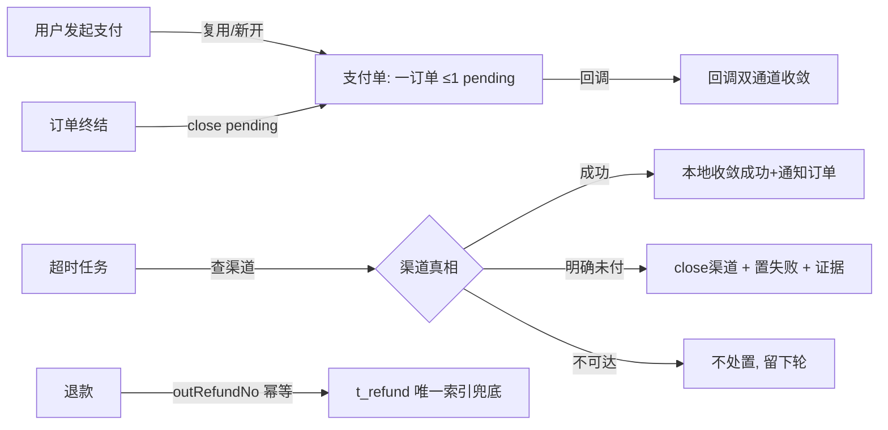

# 技术方案: 支付模块生产化改造

> 机器可读的迭代协议产物之一。把 prd.md 的 REQ 转化为**实现任务与观测点**。
> 纪律：具体方法逻辑以代码为准，本文件只说明「调哪个接口/方法 + 它在整条链路中的位置」。

## 方案概述

五阶段（禁止 big bang，每阶段可独立验证）：

| 阶段 | 内容 | 独立价值 |
|---|---|---|
| ① 支付单复用 | 唯一索引 + pay() 复用 + 并发兜底 + 拦新死键清理 | 消灭"放弃后 30 分钟不可重试" |
| ② 换渠道 | `strategy.close` 扩展 + 旧单 status=4 + 新开 | 消灭"换渠道被拒"与旧交易泄漏 |
| ③ 退款出金幂等 | `t_refund.out_refund_no` 唯一索引 + 订单侧传键 | 关闭"部分退款+响应丢失"重复出金窗口 |
| ④ 超时处置生产化 | 按渠道真相处置 + close + 证据 | GAP-1/2/3 修复 |
| ⑤ 咬合与清理 | 订单终结 close pending + 死配置/注释/模拟器/锁 TTL/结算语义 | 模块对照 04 §7 收口 |

## 系统链路（现状 → 目标）



## REQ → 任务映射

### 阶段① 支付单复用（REQ-1 / AC-1）

| REQ/AC | 实现任务 | 涉及文件/模块 | 观测点 |
|--------|---------|--------------|--------|
| AC-1 | T1.1 DDL：`t_payment` 增函数唯一索引 `uk_order_pending`（MySQL 8.0：`(CASE WHEN status=0 AND deleted=0 THEN order_id END)`，已核实部署为 mysql:8.0）+ 迁移脚本 `sql/migration/payment/V2__pending_unique.sql`（先清理后建索引；存量多条 pending → **留最新、其余置已关闭(4)**——未支付≠失败，与换渠道/终结关闭语义统一；偏离 06 §七"置失败(2)"的记录，理由如上） | `sql/init-all.sql`、`sql/migration/payment/` | 建表/迁移脚本 |
| AC-1 | T1.2 `pay()` 重写：查 pending（`WHERE order_id=? AND status=0 AND deleted=0`）→ 同渠道复用（返回同 paymentNo + 补记 `t_payment_event` REUSE）；并发 INSERT 撞 `uk_order_pending` → DuplicateKey → 重查复用；**复用路径不产生新记录：catch 清理（删本次新建记录）仅针对新建分支（paymentRecordId 仅新建时赋值）——绝不删除既有 pending** | `service/PaymentService.java` | 单测：复用/并发兜底/复用不误删 |
| AC-1 | T1.3 拦新死键清理（已核实唯一读点=`pay()` 锁后 `statusKey` 读 → 拒绝）：移除该读点；随后 `statusKey` 写入点（pay 成功/失败/超时/退款路径共 6 处）与 `payingKey`（只写不读，3 处）一并清理——全仓已核实无外部读者 | `service/PaymentService.java`、`constant/RedisKeyConstant.java` | 单测：无 30min 拒绝 |
| AC-1 | T1.4 兼容与存量测试改写：已支付/已关闭订单发起 → 维持现返回（P1-1 回查拒绝）；**存量用例 `PaymentServiceTest#paymentDuplicatePrevention`（防重拦截断言）改写为"同渠道复用"断言** | 同上、`src/test` | 单测 |

### 阶段② 换渠道（REQ-1 / AC-2）

| REQ/AC | 实现任务 | 涉及文件/模块 | 观测点 |
|--------|---------|--------------|--------|
| AC-2 | T2.1 `PayChannelStrategy` 增 `close(paymentNo)`；三实现（Mock/Alipay/Wechat——均为模拟器形态）实现：标记渠道交易关闭 | `strategy/`、`strategy/impl/` | 接口 + 单测 |
| AC-2 | T2.2 `pay()` 换渠道分支：pending 存在 + 渠道不同 → `strategy.close(旧)` → 旧单 `status=4 已关闭`（乐观锁）→ 新建新渠道单；close 失败降级（记日志 + 旧单仍关闭，靠对账兜底） | `service/PaymentService.java` | 单测：换渠道矩阵 |
| AC-2 | T2.3 `t_payment.status` 语义扩展：4=已关闭（DDL 注释 + 状态常量）；查询接口对 4 的展示兼容 | `sql/init-all.sql`、`service/PaymentService.java` | 单测 |

### 阶段③ 退款出金幂等（REQ-2 / AC-3）

| REQ/AC | 实现任务 | 涉及文件/模块 | 观测点 |
|--------|---------|--------------|--------|
| AC-3 | T3.1 DDL：`t_refund` 增 `out_refund_no VARCHAR(64)` + 唯一索引 `uk_out_refund_no`（NULL 不参与唯一） | `sql/init-all.sql` | 建表语句 |
| AC-3 | T3.2 `refundByOrder`/`doRefund` 接受 `outRefundNo`：存在则先查（命中 → 返回既有 refundNo，幂等）；插入撞唯一索引 → 重查返回；无键调用走现行为（日志） | `service/PaymentService.java`、`dto` | 单测：幂等/并发 |
| AC-3 | T3.3 订单侧传键（**唯一调用方已核实：`AftersaleService.executeRefund`**——退款全部经售后链路发起，不存在其他 `refundByOrder` 调用点）：以 `aftersaleNo` 为键；售后恢复/重试（`recoverStuckAndRetry`/`retryRefund`）沿用同键；支付域内部自动退款（`handlePaySuccessInternal` 业务拒绝分支）不传键（其幂等由支付单状态迁移保证） | `my-xhs-order`：`AftersaleService` | 单测：重试同键 |

### 阶段④ 超时处置生产化（REQ-3 / AC-4/5）

| REQ/AC | 实现任务 | 涉及文件/模块 | 观测点 |
|--------|---------|--------------|--------|
| AC-4/5 | T4.1 `checkPaymentTimeout` 重写（逐单矩阵）：`strategy.queryPayStatus` → 成功=本地收敛（复用 `handlePaySuccessInternal(orderId, userId, paymentNo, tradeNo)` 收敛体：乐观锁 0→1 + 通知订单 + 自动退款语义）；明确未付=`strategy.close` + 置失败；**不可达=不处置**（下一轮重扫）；批量仍 LIMIT+游标 | `service/PaymentService.java` | 单测：矩阵三分支 |
| AC-4/5 | T4.2 核实证据：**定为列** `t_payment.verify_method TINYINT NULL`（1=渠道已确认未支付 / 2=超时未核实）——可查询，支撑 AC-9 对账核查分支；置失败时写入 | `sql/init-all.sql`、`service/PaymentService.java` | 单测：证据落库 |
| AC-9 | T4.4 对账核查分支（GAP-4）：`PaymentReconcileJob` 增扫 `status=2 AND verify_method=2`（未核实失败单）→ `queryPayStatus` → 渠道已付 → 收敛成功 + 通知订单；渠道确认未付 → 补记 verify_method=1 | `job/PaymentReconcileJob.java`、`service/PaymentService.java` | 单测：核查分支 |
| AC-7 | T4.3 `pay.timeout.ms` 接线（`@Value` 替换硬编码 `PAY_TIMEOUT_MS`）；`refund.timeout.days` 接线 | `service/PaymentService.java`、`application.yml` | 单测：配置生效 |

### 阶段⑤ 咬合与清理（REQ-4/5 / AC-6/7）

| REQ/AC | 实现任务 | 涉及文件/模块 | 观测点 |
|--------|---------|--------------|--------|
| AC-6 | T5.1 支付侧新增 `OrderTerminationConsumer`（订阅 `ORDER_TERMINATION_TOPIC`，group=`payment-order-termination-consumer-group`，`maxReconsumeTimes=5`——与 inventory/coupon 消费者同构；事件载荷已含 `orderId`）→ 调 `closePending(orderId)`：关该订单 pending 支付单（status=4 + 渠道 close，幂等） | `consumer/OrderTerminationConsumer.java`（新）、`service/PaymentService.java` | 单测：消费→close |
| AC-6 | T5.2 订单侧**零改动**：终结事件由既有 04B 事务消息链路天然投递（"订阅方异步联动"——与库存/券/通知同模式）；重试/DLQ 由消费者组保障 | `my-xhs-order`（仅验证，无改动） | 单测：载荷含 orderId |
| AC-7 | T5.3 清理批（清单已核实）：① 注释漂移——`PayCallbackController` 引用 ×3（Alipay/Wechat 策略 javadoc + `PaymentService:320`；该类不存在，回调实为 `PayCallbackSimulator` 直调 service）+ T-077 注释（"order 无 REFUND_RESULT_TOPIC 消费者"已过期）；② 模拟器参数配置化（`PayCallbackSimulator` 90% 成功率 / 1~3s 延迟 → `@Value`）；③ `checkPaymentTimeout` 锁 TTL（5min）与周期对齐；④ 结算差异"自动收敛为已忽略"复核（结论落注释 + 保留语义） | payment 各文件 | 单测/检查 |

### 回归（REQ-6 / AC-8）

| REQ/AC | 实现任务 | 观测点 |
|--------|---------|--------|
| AC-8 | 全模块基线保持（common/product/coupon/order/inventory/payment）+ 新增用例 | 全量测试报告 |

## 接口与数据变更

- **对外接口**：`/api/payment/pay`（复用语义：不再"请勿重复支付"，改复用）；`/api/payment/refund-by-order`（请求体 +`outRefundNo`，可选）；新增内部 `close-pending`
- **模块间通信**：订单终结 → 支付 close-pending（Feign/消息，复用既有通道）
- **数据模型**：

```sql
-- ① t_payment：一订单 ≤1 pending（MySQL 8.0 函数索引）
ALTER TABLE t_payment ADD UNIQUE INDEX uk_order_pending
  ((CASE WHEN status = 0 AND deleted = 0 THEN order_id END));
ALTER TABLE t_payment ADD COLUMN verify_method TINYINT NULL COMMENT '置失败核实方式：1渠道确认未支付 2超时未核实';
-- status 注释扩展：0待支付 1成功 2失败 3已退款 4已关闭

-- ② t_refund：出金幂等键
ALTER TABLE t_refund ADD COLUMN out_refund_no VARCHAR(64) NULL COMMENT '业务幂等键（订单侧传入）';
ALTER TABLE t_refund ADD UNIQUE INDEX uk_out_refund_no (out_refund_no);
```

## 关键设计决策

| 决策 | 结论 | 理由 / 权衡 |
|------|------|------------|
| 复用/换渠道 | 同渠道复用；换渠道 close+新开；唯一索引兜底 | 主流生产做法（06 §七 §7.6）；支付单=渠道凭证 |
| 幂等键形态 | 业务键（售后单号/补偿同键）+ 唯一索引兜底 | 出金幂等硬要求；兼容无键调用 |
| 超时处置 | 渠道成功→收敛；未付→失败+close；不可达→不处置 | "不知道"≠"没付"（06 §八） |
| 订单终结咬合 | **payment 侧订阅终结事件**（`OrderTerminationConsumer`，与库存/券同构）→ close pending；订单侧零改动 | 04B"订阅方异步联动"模式；自带重试/DLQ |
| 死键处置 | `statusKey` 读点移除；`payingKey` 写点评估收敛 | 06 §七 §7.3 |
| 占位消费者/验签 | 保留占位；验签不做（记录） | 控制范围 |

## 风险与降级

| 风险 | 影响 | 缓解 / 降级 |
|------|------|------------|
| 唯一索引迁移（存量多 pending） | 建索引失败 | 迁移脚本先清理（留最新）再建；测试库验证 |
| 复用改动影响订单侧交互 | 支付链路回归 | 全模块测试基线；P1-1 回查语义不变 |
| 超时处置查渠道引入延迟 | 任务变慢 | 逐单 try/catch + 批量上限；不可达快速失败 |
| close 渠道失败 | 旧交易泄漏 | 记日志 + 对账兜底（既有机制）；本地状态仍推进 |
| 退款幂等键契约变更 | 订单侧适配遗漏 | 键为可选参数（兼容）；订单侧调用点逐处更新 |

## 人工决策点（已由 Owner 决策，2026-10-16）

- 决策 1~5 见 prd.md §人工决策点（复用/换渠道、幂等键、超时矩阵、终结咬合、占位/验签）
