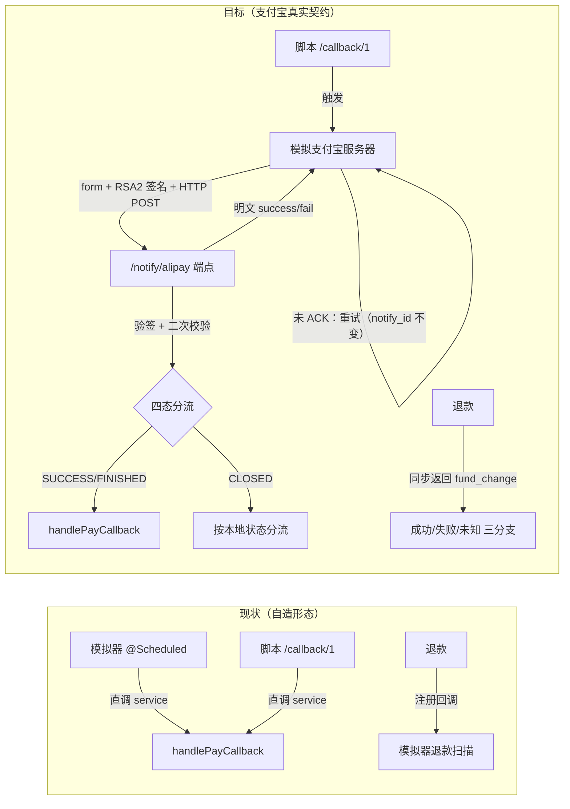

# 技术方案: 渠道契约对齐支付宝

> 机器可读的迭代协议产物之一。把 prd.md 的 REQ 转化为**实现任务与观测点**。
> 纪律：具体方法逻辑以代码为准，本文件只说明「调哪个接口/方法 + 它在整条链路中的位置」。

## 方案概述

五阶段（禁止 big bang，每阶段可独立验证）：

| 阶段 | 内容 | 独立价值 |
|---|---|---|
| ① 契约层与密钥体系 | `alipay` 包 + RSA2 双向签名工具 + 两对密钥配置 + 四态枚举/映射表 | 真实契约的"词汇表"就位 |
| ② 通知端点 | `POST /api/payment/notify/alipay`（form+验签+二次校验+ACK+四态分流） | 支付域"第三方入站口"成形 |
| ③ 模拟支付宝服务器 | 交易台账 + 付款模拟 + 通知投递/重试 + query/close/refund + 故障注入 | 渠道替身升级为"契约级" |
| ④ 链路切换 | 直调→HTTP 真实通知；触发口重实现；退款同步化；死链删除；微信删除；先查后决 | 两条回调路径收口 + 退款形态对齐 |
| ⑤ 收口 | 网关白名单两行 + 脚本 + deploy 迁移补齐 + 文档 + 回归 | 跨模块闭环 |

## 系统链路（现状 → 目标）

## REQ → 任务映射

### 阶段① 契约层与密钥体系（REQ-1 / AC-1/2）

| REQ/AC | 实现任务 | 涉及文件/模块 | 观测点 |
|--------|---------|--------------|--------|
| AC-1 | T1.1 契约包：`alipay/AlipayTradeStatus`（WAIT_BUYER_PAY/TRADE_SUCCESS/TRADE_FINISHED/TRADE_CLOSED 四态枚举）；`AlipayNotifyParams`（通知参数模型：outTradeNo/tradeNo/tradeStatus/totalAmount/appId/sellerId/notifyId/sign…）；`AlipayTradeQueryResult`；`RefundTradeResult`（fundChange/tradeNo/errorCode） | `payment/alipay/`（新包） | 类 + 单测 |
| AC-1 | T1.2 `AlipaySignatureUtil`：`sign(params, privateKey)` / `verify(params, publicKey)`；RSA2=SHA256withRSA；待验签串=剔除 `sign`/`sign_type` + **剔除空值** + 字典序 + `k=v&` 拼接（通知方向值先 URLDecode，以 SDK `AlipaySignature.getSignCheckContentV1` 行为为准——注释引用） | `payment/alipay/AlipaySignatureUtil.java` | 单测：roundtrip/空值/中文/篡改/错钥 |
| AC-1 | T1.3 密钥配置：`AlipayMockProperties`（`payment.alipay.mock.*`：appId/sellerId/**merchantPrivateKey/merchantPublicKey**（应用密钥对）/ **alipayPrivateKey/alipayPublicKey**（支付宝密钥对）/ notifyUrl/retry 节奏/成功率/延迟）；本地生成两对密钥写入 `application.yml`（标注 MOCK-DEV-ONLY） | `payment/config/AlipayMockProperties.java`、`application.yml` | 配置绑定 + 单测 |
| AC-2 | T1.4 `AlipayTradeClient` 接口 + `AlipayTradeClientImpl`（商户侧 SDK 形态；委托 `SimulatedAlipayServer`；请求方向带真实签名）：`tradeCreate(orderId, amount, subject, outTradeNo)` / `tradeQuery(outTradeNo)` / `tradeClose(outTradeNo)` / `tradeRefund(outTradeNo, outRequestNo, amount, reason)` / `verifyNotify(params)` | `payment/alipay/AlipayTradeClient.java` 等 | 接口 + 单测 |
| AC-2 | T1.5 `queryPayStatus` 映射表（`AlipayPayStrategy` 内显式 switch）：WAIT_BUYER_PAY→0；TRADE_SUCCESS/TRADE_FINISHED→1；TRADE_CLOSED→0（对本地 pending 单=未付超时关闭）；不可达/未知→null | `strategy/impl/AlipayPayStrategy.java` | 单测：5 分支 |

### 阶段② 通知端点（REQ-2 / AC-3/4/5）

| REQ/AC | 实现任务 | 涉及文件/模块 | 观测点 |
|--------|---------|--------------|--------|
| AC-3 | T2.1 `AlipayNotifyController`：`POST /api/payment/notify/alipay`；收集 form 参数（`@RequestParam Map<String,String>`）；调用 `verifyNotify` 验签；**明文应答**（`"success"`/`"fail"`，绕过统一响应包装）；异常→catch→`"fail"`+日志 | `controller/AlipayNotifyController.java`（新） | MockMvc 单测 |
| AC-3/4 | T2.2 **二次校验**（验签通过后）：① `out_trade_no` 对应支付单存在（`t_payment`）② `total_amount` 与支付单金额一致 ③ `app_id`/`seller_id` 与配置一致；任一不过 → 告警日志 + `"fail"`（不处理） | 同上 + `service/PaymentService.java`（查询入口） | MockMvc 单测：三失败分支 |
| AC-5 | T2.3 四态分流：TRADE_SUCCESS/TRADE_FINISHED → `handlePayCallback(paymentNo, tradeNo, true)`（含迟到成功受理）；TRADE_CLOSED → **按本地状态分流**：本地 pending(0) → `handlePayCallback(..., false)`（渠道确认关闭）；本地已成功(1)/已退款(3) → 幂等/退款收敛（no-op）；WAIT_BUYER_PAY → 忽略（日志） | 同上 | MockMvc 单测：四态 + 迟到成功 |
| AC-3 | T2.4 幂等应答：重复通知（重试）→ 业务幂等（既有 CAS）→ `"success"`；处理抛异常 → `"fail"`（渠道重试） | 同上 | MockMvc 单测：重复/异常 |

### 阶段③ 模拟支付宝服务器（REQ-3 / AC-6/7/8）

| REQ/AC | 实现任务 | 涉及文件/模块 | 观测点 |
|--------|---------|--------------|--------|
| AC-6 | T3.1 交易台账：Redis Hash `myxhs:payment:mock-alipay:trade:{outTradeNo}`（amount/subject/tradeNo/status/notify 投递态 attempts+nextRetryAt/closedAt）；`createTrade` 建立（WAIT_BUYER_PAY）；状态迁移原子（Lua 或 CAS 语义：WAIT→SUCCESS 仅一次） | `simulator/SimulatedAlipayServer.java`（新，承接 `PayCallbackSimulator` 渠道替身职责） | 单测：建账/迁移 |
| AC-8 | T3.2 请求契约（进程内 + 真实签名）：`handleCreateTrade/handleQueryTrade/handleCloseTrade/handleRefundTrade`——验商户签名；query 返回四态；close 置 TRADE_CLOSED；refund **同步返回 fundChange** + 幂等键 `myxhs:payment:mock-alipay:refund:{outRequestNo}`（**同号只退一次**）；全退后台账置 TRADE_CLOSED | 同上 | 单测：四操作 + 退款幂等 |
| AC-7 | T3.3 通知投递器：构造参数（notify_time/notify_type=trade_status_sync/notify_id（生成一次、**重试不变**）/out_trade_no/trade_no/trade_status/total_amount/app_id/seller_id/subject + `sign`）→ `RestTemplate` POST（form-urlencoded，URL=配置 `notifyUrl`，默认 `http://localhost:${server.port}/api/payment/notify/alipay`）→ 读响应体判断 ACK；未 ACK → 重试调度（简化节奏可配，默认 5s/15s/60s，上限 8 次；`notify_id` 不变）；上限后放弃（台账记 undelivered → 查单兜底） | 同上 + `simulator/AlipayNotifySender.java` | 单测：参数完整性/重试调度/放弃 |
| AC-8 | T3.4 "用户付款"模拟：createTrade 后按配置延迟（默认 1~3s）+ 成功率（默认 90%）自动转 TRADE_SUCCESS → 触发通知投递；确定性触发口 `triggerPay(outTradeNo, outcome)`（供脚本/测试） | 同上 | 单测：自动/触发 |
| AC-8 | T3.5 故障注入（配置/触发）：退款异常、通知投递失败、渠道不可达（query 返回 null）——供竞态/恢复场景测试 | 同上 | 单测：注入生效 |

### 阶段④ 链路切换（REQ-4/5 / AC-9/10/11）

| REQ/AC | 实现任务 | 涉及文件/模块 | 观测点 |
|--------|---------|--------------|--------|
| AC-9 | T4.1 `PayCallbackSimulator` 支付回调部分改造：退役"直调 service + pending 键"机制 → 由 `SimulatedAlipayServer`（台账 + 通知投递）承接；自动付款→真实 HTTP 通知 | `simulator/PayCallbackSimulator.java` | 单测：全链路 roundtrip |
| AC-9 | T4.2 `/callback/{payType}` 重实现：payType=1 → 解析 out_trade_no → `triggerPay(outTradeNo, SUCCESS)`（走真实链路：签名→端点→验签→处理→ACK）；payType=99 → 保持兼容直调（`handlePayCallback`）；保留 `X-Internal-Call` 守卫（测试触发口定位，管道类最小处理） | `controller/PaymentController.java` | 单测：1 真实链路 / 99 兼容 |
| AC-10 | T4.3 退款同步化：`PayChannelStrategy.refund` 返回类型 → `RefundTradeResult`；三实现改造（Mock=恒成功；Alipay=契约层同步结果；Wechat 删除）；`PaymentService` 退款流三分支：fundChange=true → `handleRefundSuccessInternal`；false → `markRefundFailed`（保持现语义）；异常/未知 → 停留退款中（恢复任务同 out 键重试） | `strategy/PayChannelStrategy.java`、`strategy/impl/`、`service/PaymentService.java` | 单测：三分支 |
| AC-10 | T4.4 退款回调整链删除（引用面已核实）：`registerRefundCallback`/`simulateRefundCallback`/`REFUND_CALLBACK_PENDING_PREFIX`（模拟器）；`/refund-callback/{payType}` 端点（控制器 + `extractRefundNo`/`extractRefundResult` 辅助）；`handleRefundCallback`（接口 + 3 实现 + 服务方法）；相关测试改写/清理 | `simulator/`、`controller/PaymentController.java`、`strategy/`、`service/PaymentService.java`、`src/test` | 编译 + 全仓 grep 无死引用 |
| AC-10 | T4.5 微信渠道删除：`WechatPayStrategy` 删除 + `PayStrategyConfig` 注册移除 + 注释/引用清理（已核实引用面：配置/注释） | `strategy/impl/WechatPayStrategy.java`、`config/PayStrategyConfig.java` | 编译 + 单测 |
| AC-11 | T4.6 换渠道"先查后决"（`pay()` 换渠道分支改造）：pending 渠道不同 → `queryPayStatus(旧)`：1 → **受理**（`handlePaySuccessInternal` 收敛 + 返回旧单，不新建）；0 → `strategy.close(旧)` → 旧单 status=4 → 新建；null → **不切换**（报错"渠道暂不可达，请稍后重试"）；**close 失败再查**：已付→受理 / 未付→报错；保留"closed+迟到成功"兜底（C-002） | `service/PaymentService.java` | 单测：矩阵四分支 |

### 阶段⑤ 收口（REQ-6 / AC-12/13）

| REQ/AC | 实现任务 | 涉及文件/模块 | 观测点 |
|--------|---------|--------------|--------|
| AC-12 | T5.1 网关两条白名单加 `/api/payment/notify/**`（`auth.white-list` + `auth.hmac-white-list`；两行配置，管道类最小处理） | `my-xhs-gateway/application.yml` | 配置检查 |
| AC-12 | T5.2 脚本同步：`test-10-payment.py` 删 refund-callback 步骤（保留 callback/99 步骤）；`test-order-state-race.py` 4 处 `/refund-callback/99` 调用更新（退款竞态场景改故障注入说明）；test-09 / e2e / smoke / full-chain 零改动（核验） | `scripts/` | 脚本 review |
| AC-12 | T5.3 deploy zip 补齐 `V2__pending_unique.sql`（C-002 遗留缺口） | `deploy/docker/my-xhs-deploy-zip/sql/migration/payment/` | 文件比对 |
| AC-12 | T5.4 文档：`docs/学习/订单-改造/02-改造后文章修订记录.md` 补 C-003 条目（06-支付联动/04-支付 相关）；`.harness/CONTEXT.md` 补术语（交易台账/契约层/通知投递/先查后决） | 文档 | review |
| AC-13 | T5.5 全模块回归：六模块全量重编测试（删 `target/test-classes`） | 全仓 | 测试报告 |

## 接口与数据变更

- **对外接口**：
  - 新增 `POST /api/payment/notify/alipay`（form；明文 `"success"`/`"fail"`）
  - `/api/payment/callback/{payType}`：语义升级（测试触发口；1→真实链路、99→兼容直调），路径保留
  - 删除 `POST /api/payment/refund-callback/{payType}`
- **数据模型**：无 SQL 变更
- **Redis 键（新增）**：
  - `myxhs:payment:mock-alipay:trade:{outTradeNo}`（台账 Hash）
  - `myxhs:payment:mock-alipay:refund:{outRequestNo}`（退款幂等"同号只退一次"）
  - `myxhs:payment:mock-alipay:notify-lock:{outTradeNo}`（投递锁，防多实例重复投递）
- **配置（新增）**：`payment.alipay.mock.*`（appId/sellerId/两对密钥/notify-url/retry-intervals/retry-max-attempts/success-rate/callback-delay-min-ms/callback-delay-max-ms）

## 关键设计决策

| 决策 | 结论 | 理由 / 权衡 |
|------|------|------------|
| 架构分层 | 方案 B：`alipay` 契约包隔离；`PayChannelStrategy` 仅必要变更 | 业务链路零改动；换真渠道=换契约层实现 |
| 验签 | 真做：两对本地密钥；通知方向真实 HTTP；双向签名 | 验签是渠道契约核心；本地密钥对流程与线上一致 |
| 通知方向 | 真实 HTTP POST（模拟服务器→notify 端点）+ ACK + 重试 | 跨进程形态是本迭代核心（签名→网络→验签→ACK） |
| 请求方向 | 进程内调用 + 真实签名验签（不造本地网关端点） | 控制范围；请求方向无"投递"问题 |
| 退款 | 同步化（fund_change）；删回调整链；竞态用故障注入 | 支付宝退款同步是真实契约；死代码必清 |
| 换渠道 | 先查后决（官方指引）+ close 失败再查 | 消灭 TOCTOU；已付不重发 |
| 触发口 | `/callback/{payType}` 保留（1 真实链路 / 99 兼容） | 脚本零改动；测试覆盖完整真实链路 |
| 处理时机 | 同步处理 + 幂等（不落库异步） | 处理段仅 CAS+发 MQ；控制范围 |
| 管道类 | 白名单两行 + X-Internal-Call 保持（最小必要） | Owner 口径：不作为设计题 |

## 风险与降级

| 风险 | 影响 | 缓解 / 降级 |
|------|------|------------|
| 验签实现细节偏差（空值/URLDecode 规则） | 端点验签行为与真实 SDK 不一致 | 以 `AlipaySignature.getSignCheckContentV1` 行为为准 + 单测覆盖边界 + 注释引用 |
| 通知投递自循环 HTTP（本机端口） | 单测依赖网络 | 投递器抽 `AlipayNotifySender`（HTTP 客户端可 mock）；单测不真起服务；URL 可配 |
| `/callback/1` 行为变化影响脚本 | 冒烟失败 | 路径与入参格式保留；触发语义升级；脚本核验 |
| 退款回调整链删除的存量测试 | 测试编译失败 | 逐处改写清单（执行时列全）；全仓 grep 无死引用 |
| 死键/死代码清理遗漏 | 遗留自造形态 | 编译 + 全仓 grep 核验（回调键/退款回调引用面） |
| 网关白名单漏配 | 部署后 notify 被拦 | 两条白名单均加（配置检查清单） |

## 人工决策点（已决策，2026-10-17——Owner 授权 AI 决策）

- 决策 1~6 见 prd.md §人工决策点（范围/架构/验签/退款/触发口/处理时机）
